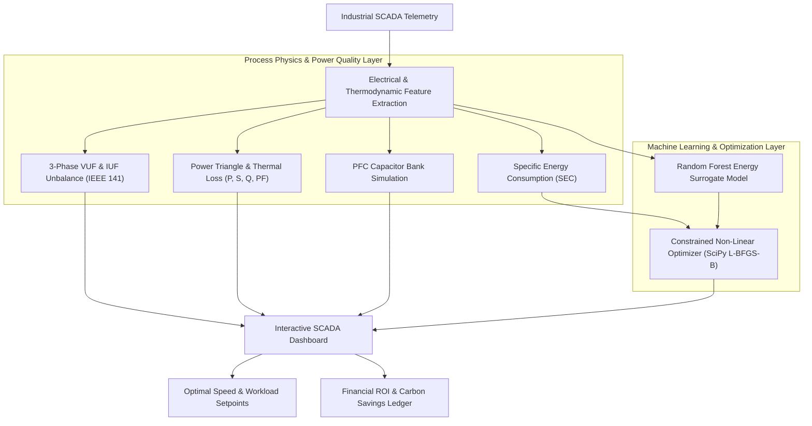

# ⚡ Siemens Process Energy Optimization & Carbon Footprint Reduction Engine

[](https://www.python.org/)
[](https://streamlit.io/)
[](https://scipy.org/)
[](https://scikit-learn.org/)
[](https://www.kaggle.com/)
[](https://standards.ieee.org/)
[](https://opensource.org/licenses/MIT)

An industrial **Process Energy Optimization & Carbon Footprint Reduction Engine** designed for CNC, Lathe, and Milling machinery. This project bridges **First-Principles Electrical & Thermodynamic Engineering** (3-phase power quality, Specific Energy Consumption ($SEC$), voltage/current unbalance factors, and power factor correction) with **Constrained Non-Linear Optimization (SciPy L-BFGS-B)** and **Machine Learning Energy Surrogates** to discover optimal setpoints that minimize factory power draw and carbon emissions while strictly preserving production throughput.

---

## 📊 Dataset Provenance & Attribution

The telemetry underlying this project originates from the industrial manufacturing dataset hosted on **[Kaggle.com](https://www.kaggle.com/)**.
* **Dataset Scope:** 1,578,241 continuous operational records sampled at 1-minute resolution across 3 operational years (2022–2025).
* **Equipment Monitored:** 4 Industrial Machines (`M001`–`M004`) across 3 Machine Types (`CNC`, `Lathe`, `Milling`) and 3 Production Lines (`L1`–`L3`).
* **Sensor Channels:** 91 synchronous telemetry variables spanning Rotodynamics (speed, torque, triaxial vibration), Thermodynamics (bearing, motor, coolant temperatures), 3-Phase Electrical Quality (phase voltages $V_A, V_B, V_C$, phase currents $I_A, I_B, I_C$, active power, power factor), and Production Metrics (cycle time, production rate, scrap rate, energy efficiency index).
* **Repository Sample:** For immediate out-of-the-box execution without downloading gigabytes of raw data, this repository includes an optimized, self-contained 35,000-row sample in `data/telemetry_sample.parquet` (14.4 MB).

---

## 📌 Executive Summary

Industrial motors and machining centers consume over 60% of total electrical power in modern manufacturing facilities. Sub-optimal operating setpoints (excessive spindle speed, uncalibrated workload, low power factor, and phase unbalance) generate substantial parasitic energy losses and unnecessary $CO_2$ emissions.

This platform provides an **Energy Digital Twin & Setpoint Optimization Engine** that:
1. Calculates real-time **Specific Energy Consumption ($SEC$)** per manufactured good part.
2. Evaluates **3-Phase Power Quality** compliance against **IEEE 141 / EN 50160** standards (Voltage Unbalance Factor $VUF < 2\%$).
3. Decomposes electrical power into **Active Power ($P$)**, **Motor Thermal Losses ($P_{\text{loss}}$)**, and **Reactive Power ($Q$)**.
4. Solves a **Constrained Non-Linear Optimization Problem** via **SciPy (`L-BFGS-B`)** to discover optimal Spindle Speed (RPM) and Workload (%) setpoints that minimize power demand while preserving throughput.
5. Simulates **Power Factor Correction (PFC)** capacitor banks to eliminate reactive demand penalties and reduce distribution line $I^2 R$ heat losses.
6. Projects annualized **Financial Energy Savings ($/year)** and **Carbon Footprint Reduction (Metric Tons $CO_2$/year)** based on regional grid emission factors.

---

## 🏗️ System Architecture



---

## 🔬 Process Engineering & Mathematical Formulations

### 1. Specific Energy Consumption ($SEC$)
Quantifies the electrical energy (kWh) required to produce one defect-free unit:

$$SEC = \frac{P_{\text{kW}} \times \left(\frac{t_{\text{cycle}}}{3600}\right)}{\text{ProductionRate}_{\text{parts/hr}} \times (1 - \text{ScrapRate})} \quad \left[\frac{\text{kWh}}{\text{good part}}\right]$$

### 2. 3-Phase Voltage Unbalance Factor ($VUF$) & IEEE 141 Standard
Unbalanced voltages cause disproportionate negative-sequence currents, leading to severe motor overheating:

$$V_{\text{avg}} = \frac{V_A + V_B + V_C}{3}$$

$$VUF\% = \frac{\max\left(|V_A - V_{\text{avg}}|, |V_B - V_{\text{avg}}|, |V_C - V_{\text{avg}}|\right)}{V_{\text{avg}}} \times 100\%$$

* 🟢 **$VUF < 2.0\%$ (Balanced):** Compliant with IEEE 141 / EN 50160; nominal motor rating.
* ⚠️ **$VUF \ge 2.0\%$ (Unbalanced):** Requires motor derating to prevent winding insulation breakdown.

### 3. Electrical Power Triangle & Reactive Power ($Q$)
Given active power $P$ (kW) and displacement power factor $PF = \cos\phi$:

$$S = \frac{P}{PF} \quad [\text{kVA}], \qquad Q = \sqrt{S^2 - P^2} \quad [\text{kVAR}]$$

### 4. Power Factor Correction (Capacitor Bank Sizing)
Required reactive relief to raise power factor from $PF_1$ to target $PF_2 = 0.95$:

$$Q_C = P \left[\tan(\arccos(PF_1)) - \tan(\arccos(PF_2))\right] \quad [\text{kVAR}]$$

Feeder line current reduction:

$$\Delta I\% = \left(1 - \frac{PF_1}{PF_2}\right) \times 100\%$$

### 5. Constrained Non-Linear Setpoint Optimization
The optimizer searches the decision space $\mathbf{x} = [\text{RPM}, \text{Workload}\%]$ to minimize total power demand while ensuring target throughput:

$$\min_{\mathbf{x}} \; P(\mathbf{x}) + \lambda \cdot \max\left(0, \; \text{TargetThroughput} - \text{Throughput}(\mathbf{x})\right)^2$$

Subject to physical operational bounds:
$$\text{RPM} \in [800, 2600], \qquad \text{Workload}\% \in [30\%, 95\%]$$

---

## 🤖 Machine Learning Architecture

| Component | Model Algorithm | Input Features | Target Output |
| :--- | :--- | :--- | :--- |
| **Power Demand Surrogate** | **Random Forest Regressor** | Spindle RPM, Load Torque, Workload %, Temperatures, Viscosity, Vibration | Active Power Consumption ($P$ in kW) |
| **Setpoint Solver** | **SciPy `minimize` (L-BFGS-B)** | Surrogate Objective + Throughput Penalty Function | Pareto Optimal $[\text{RPM}^*, \text{Workload}^*]$ |

---

## 🖥️ Interactive Dashboard Features

* **SCADA Executive KPI Cards:** Zero-overlap, high-contrast digital readouts for Active Power (kW), Specific Energy ($SEC$), Voltage Unbalance ($VUF\%$), Hourly Carbon Rate (kg $CO_2$/hr), and Reactive Power ($Q$ in kVAR).
* **AI Setpoint Optimizer Lab:** Interactive slider to set target production throughput (parts/hr) and trigger instant SciPy non-linear solver with live Before vs. After comparison cards.
* **Decarbonization & Economic Savings Ledger:** Annualized financial savings (\$/year) and carbon mitigation (Metric Tons $CO_2$/year) computed across customized operational hours (e.g. 6,000 hrs/yr).
* **3-Phase Power Quality & Thermal Balance:** Interactive Phase A, B, C voltage and current balance visualizers alongside Apparent Power breakdown (Useful Work vs Motor Heat Dissipation vs Reactive Demand).
* **Historical Operating Regime Mapping:** 4D interactive scatter plot of Power Demand vs. RPM, colored by Energy Efficiency Index and sized by Workload %.
* **Power Factor Correction (PFC) Simulator:** Real-time capacitor bank sizing calculator with line current relief estimations.
* **Timeline Scrubber:** Precise 1-minute replay scrubber displaying formatted timestamps (`📅 YYYY-MM-DD HH:MM:SS`).

---

## 📂 Repository Structure

```
siemens-process-energy-optimization/
├── app.py                      # Interactive Streamlit SCADA & Optimizer Dashboard
├── train.py                    # Model training & performance evaluation script
├── requirements.txt            # Python dependencies
├── LICENSE                     # MIT License
├── .gitignore                  # Git ignore rules
├── .streamlit/
│   └── config.toml             # High-contrast SCADA theme configuration
├── .github/
│   └── workflows/
│       └── ci.yml              # Automated GitHub Actions CI workflow
├── data/
│   └── telemetry_sample.parquet # Representative sample dataset (35k rows)
├── models/                     # Serialized ML surrogate model (.pkl)
│   └── energy_surrogate_model.pkl
└── src/                        # Core engineering modules
    ├── __init__.py
    ├── data_loader.py          # Data ingestion with Kaggle attribution
    └── energy_engine.py        # 3-Phase physics, SEC, PFC, & SciPy optimizer
```

---

## 🚀 Quickstart Guide

### 1. Clone the Repository
```bash
git clone https://github.com/<your-username>/siemens-process-energy-optimization.git
cd siemens-process-energy-optimization
```

### 2. Create and Activate Virtual Environment
```bash
python3 -m venv venv
source venv/bin/activate        # On Windows: venv\Scripts\activate
```

### 3. Install Dependencies
```bash
pip install -r requirements.txt
```

### 4. (Optional) Retrain Energy Surrogate Model
```bash
python train.py
```

### 5. Launch the Interactive Dashboard
```bash
streamlit run app.py
```
*Open your browser at `http://localhost:8501` to explore the interactive dashboard.*

---

## 🧪 Automated Testing & CI

This repository includes automated tests running via GitHub Actions on Python 3.10 and 3.11. To execute tests locally:

```bash
python -c "
from src.data_loader import load_data
from src.energy_engine import (
    calculate_power_quality_metrics,
    calculate_sec,
    calculate_pfc_simulation,
    optimize_operating_setpoints
)
df = load_data(nrows=100)
row = df.iloc[0]
pq = calculate_power_quality_metrics(row)
sec = calculate_sec(row['Power_Consumption'], row['Cycle_Time'], row['Production_Rate'], row['Scrap_Rate'])
opt = optimize_operating_setpoints(row)
print('✅ All Physics, Power Quality, and Optimizer Tests Passed!')
"
```

---

## 📜 License

This project is open-source under the [MIT License](LICENSE).
